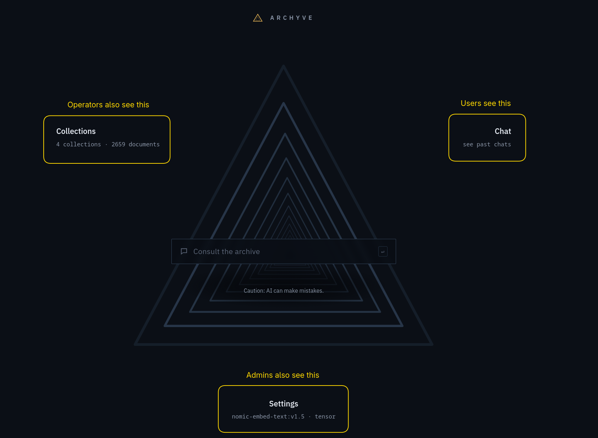
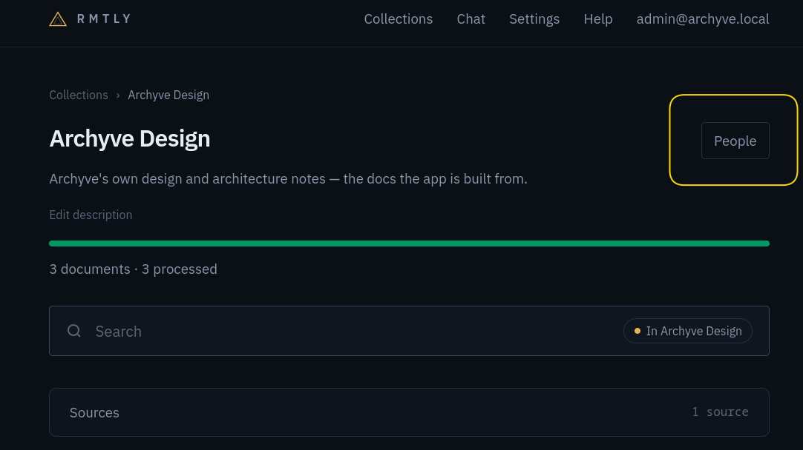

# Access and roles

Access in Archyve has two parts: a **role** that applies everywhere, and **grants** on individual collections and sources.

## Roles

There are three roles in Archyve: Visitor, Curator, and Admin. Privileges are cumulative: Curator has a superset of the privileges of Visitor, and Admin has a superset of the privileges of Curator.

| Role | Can |
|---|---|
| Visitor | Can access Chat |
| Curator | Can also manage Sources and Collections |
| Admin | Can also manage Endpoints, settings, and people |

For details on Endpoints, Sources, and Collections, see [Processing flow](processing.md).

### Visitor

Visitors can only access chat. They cannot manage Collections, Sources, Endpoints, or Settings. A Visitor is typically someone who uses Archyve but plays no role in defining its behaviour or its configuration.

### Curator

A Curator is responsible for curating content in Archyve. For example, a member of the HR organization might be responsible for ensuring that users get answers from the correct set of HR documents, and that those documents are current.

Curators can also chat, so they can test their users' use cases.

Curators must be granted access to certain Collections or Sources before they can manage them, so a Curator from IT should be able to manage IT's collections, but not HR's.

### Admin

An Admin has full access to Archyve: all the permissions of Curator on all Collections, plus the ability to manage Endpoints, settings, and user permissions.

## Areas of the app

The three roles map to the three main parts of the app, which are accessible from the landing page:

If a user's role does not allow them to access one of these three areas of the app, the link is not present on their landing page.

An admin changes someone's role under [Settings › People](/settings/users). Archyve always keeps at least one admin: the last one can't be demoted or deleted.

## Grants

Grants are like having a role on a specific Collection or Source.

A Grant does not allow a user to do something their role does not; for example, a Visitor with an Editor or Manager grant on a Collection is still just a Visitor, and Visitors cannot manage Collections.

If a user creates a Collection or a Source, they have the Manager grant on that Collection or Source. Visitors can create nothing, Curators can create Sources and Collections, and Admins can create anything.

Grants are managed through a "People" button in the top right of a Collection or Source page:

### Grants on Collections

Collections are sets of Sources and Documents that are grouped together so Visitors can use them in chat. They tend to be logically related, like "Human Resources documents", "IT procedures", or "Appliance manuals".

| Grant on the collection | A Visitor can | A Curator can | An Admin can |
|---|---|---|---|
| none | do nothing; it doesn't appear for them | do nothing; it doesn't appear for them | do everything; no grant needed |
| Accessor | search it and use it in Chat | search it and use it in Chat | do everything; no grant needed |
| Editor | search it and use it in Chat | also add and remove documents by hand, and trigger a sync | do everything; no grant needed |
| Manager | search it and use it in Chat | also decide who else has access, and delete it | do everything; no grant needed |

#### Examples

For example, if a user was a member of the HR department, and was responsible for managing the content available to users within the "Human Resources" Collection, that user should have the Curator role _and_ the Editor grant on Human Resources. This would let them add to or remove from the Collections.

If they were also responsible for managing who has access to that Collection, they should have the Manager grant on the Collection.

### Grants on Sources

Sources feed Collections. A Collection can have many Sources, and users with a grant on the Collection can access information from that Source in chat. Sources pull documents from external systems (via Endpoints).

| Grant on the source | A Visitor can | A Curator can | An Admin can |
|---|---|---|---|
| none | do nothing | do nothing; it doesn't appear for them | do everything; no grant needed |
| Accessor | do nothing | attach it to a collection they manage | do everything; no grant needed |
| Editor | do nothing | also change its settings and trigger a sync | do everything; no grant needed |
| Manager | do nothing | also decide who else has access, and delete it | do everything; no grant needed |

For Sources, Visitors can do nothing, because one can't use a Source directly in chat. Chats reference Collections, and Collections reference Sources.

#### Examples

For example, if a user was responsible for selecting which Books in Bookstack were going to go into a "Human Resources" Collection, they should be a Curator, so they can create Sources to pull data from specific Books in Bookstack. They should also have the Editor grant on the Collection so they can configure the Collection to draw from the Source.
