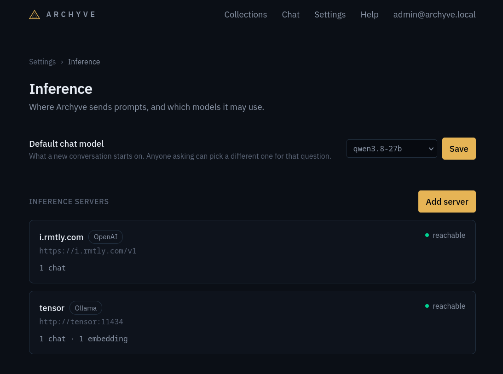

# Inference

Archyve uses AI inference for two things:

- it uses an embedding model to create vectors of information it pulls from other systems
- it uses LLMs in chat, to answer users' questions

## Inference servers

Archyve supports two flavours of inference server API: **Ollama** and **OpenAI**.

> Most inference servers present an OpenAI-compatible API, including Ollama, but knowing that an inference server is Ollama allows Archyve to get more information about model capabilities and context usage.

Archyve can access models from multiple inference servers at a time.

Inference servers are configured under [Settings › Inference](/settings/inference_servers).

### Embedding model

In order to function, Archyve requires an embedding model. The embedding model is necessary to build the vector database used to retrieve information relevant to a user query.

> Changing the embedding model would require re-indexing all content in Archyve, and Archyve does not support this yet.

Embedding models are small and fast compared to language models. An embedding model can run effectively on a modern CPU, if necessary, although it will run more slowly than it would on a GPU.

`nomic-embed-text:v1.5` is a good choice of embedding model for Archyve, balancing speed and quality. It can be run by Ollama.

### Chat model

Archyve uses a Large Language Model (LLM) for chat. Because of the role the model must play in Archyve, there are requirements on its capabilities:

- **Tool-calling**: a chat model searches Archyve using tool calls; if the model does not support tool-calling, it cannot retrieve data with which to answer user questions.
- **Context**: to be reliably useful in Archyve, a model should have a 16k-token context window. A single turn of query-answer will only use a few thousand tokens, but multi-turn chats will require more, especially in a large archive.
- **Multi-turn capability**: a chat model must be intelligent enough to handle follow-up queries within the context of the chat. Thus, the ability to pick details out of context reliably and enough intelligence to remember a goal across multiple turns are important.

## Default chat model

Archyve chooses which model to use for a chat with the **Default chat model** setting. It can be set to "First available" or to a specific model.

> Future features like chat summarization, knowledge graphs, or interactive help will add their own default model settings here.

If you remove your default model from Archyve, the setting will revert to "First available".

## Adding inference servers

To add an inference server, click **Add server** from the [inference servers page](/settings/inference_servers) page.

Choose Ollama if it is an Ollama server; otherwise choose OpenAI.

> If your server is not Ollama and does not offer an OpenAI-compatible API, Archyve does not support it.

When adding an OpenAI-compatible inference server, you can tell Archyve what server implementation is behind the API. This is important because different implementations behave differently in terms of reporting model capabilities or returning information about how much context is used.
