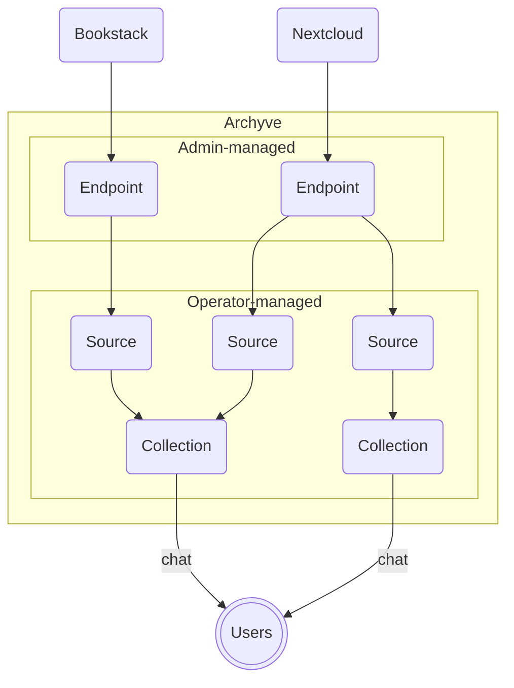

# Processing flow

Archyve pulls data from external sources and makes that data available to users in chat.

## Endpoints

Data arrives at Archyve from Endpoints, Archyve's internal representation of an external system. An Endpoint has a URL and credentials. Admins configure Endpoints. Admins would typically be an IT team or a DevOps team.

## Sources

Once Endpoints are defined, Operators choose which data to pull from those external systems using Sources.

A Source selects a subset of the data in an Endpoint. For example, a Source might pull only two specific folders from a Nextcloud server, or a three Books from a Bookstack server. Operators would typically be the people in charge of a certain data set, like HR or Finance, and would control what data about their teams was accessible in chat.

## Collections

Once Sources are defined, Operators create Collections and choose which Sources to include. A Source may feed multiple Collections.

Collections are what Users use in Chats. If data exists in a Collection, and that Collection is accessible to that User, the user can ask questions of Archyve about the data in that Collection, and Archyve's chatbot will draw on that data to answer the User's questions.

## Flow diagram

## Permissions

Access controls, including which Operators can control which Collections pull from which Sources, are details in [Access and roles](access.md).
